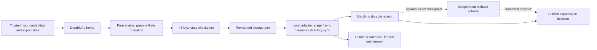

# Domain model

A principal is a stable subject reference classified as human, agent, service, or
system. Kind is descriptive and grants no authority by itself.

A capability grant is issued by one Aegis engine under an authority epoch. It binds
a subject to a finite action set and resource scope until an explicit expiry. The
opaque native grant carries the minimum bounded facts required to validate
currentness. Attenuation validates its parent at creation time; ancestry is not
retained or persisted.

The selected V1 lifecycle uses global epoch revocation only. Principal references
are stable only within the host's authority namespace; sessions are fresh
host-authenticated continuity intervals and are never rebound. See
`docs/authority-lifecycle.md` for the exact continuity and inspection boundary.

Resource scopes use a versioned sum type for known engine boundaries rather than
uninterpreted permission strings. An extension requires a new vocabulary version or
an explicit adapter-owned foreign-resource profile.

Revocation affects future validation. Historical events continue to attribute the
grant and principal that authorized them at the time.

## Implemented ownership and execution

The pure engine owns namespace, epoch and two checked allocation frontiers.
Issued opaque grants carry their validated scopes and bounded depth; the engine
does not retain a grant registry or serialize capabilities. Trusted hosts own
caller authentication, explicit time, namespace reservation and access to native
operations. The durable host owns revision/publication/fencing state; the local
adapter owns resource identity, OS locking and file barriers. Observations are
non-authoritative and contain no principal/resource/session labels.

Recovery follows `load -> validate namespace/revision -> advance epoch -> commit
fence -> expose host`. It never restores live grants. There is no network path
in this profile. Checkpoint, receipt and diagnostic flows are distinct from
caller authentication and authority. Last-confirmed metric gauges cannot clear
a fence or authorize an action.

In the optional witnessed profile, recovery adds `verify exact external anchor`
before epoch advancement, and publication adds `advance exact external anchor`
after local commit. Rollback, fork, absence behind an anchor and indeterminate
ordering are absorbing refusals for that host instance. The witness remains a
deployment-owned trust boundary, not authority state or a grant issuer.

RED/golden signals cover the four fixed operation classes, domain/admission
refusals, commit failures and residence/commit duration. USE covers the one
serialized writer, fixed 64-byte host value and checked allocation frontiers;
scope/depth ceilings remain host-visible configuration. No queue, scheduler,
implicit clock, unbounded labels or inferred SLO exists. Disabling observations
does not change checkpoints, authorization or fencing.

STRIDE: wrong namespace, stale epochs, session/subject/resource/action mismatches,
attenuation amplification and storage receipt misattribution refuse; bounded
scope work and checked counters narrow DoS. Private storage is not a hostile
same-UID or rollback defense. LINDDUN: scope/credential/grant bodies are absent
from checkpoints and diagnostics; the stable namespace, counters and filesystem
metadata still permit operational linkage and require host retention controls.
Decision evidence records attribution, not continuing authority. No repudiation,
encryption, hardware durability or independent Cleanroom certification is claimed.

